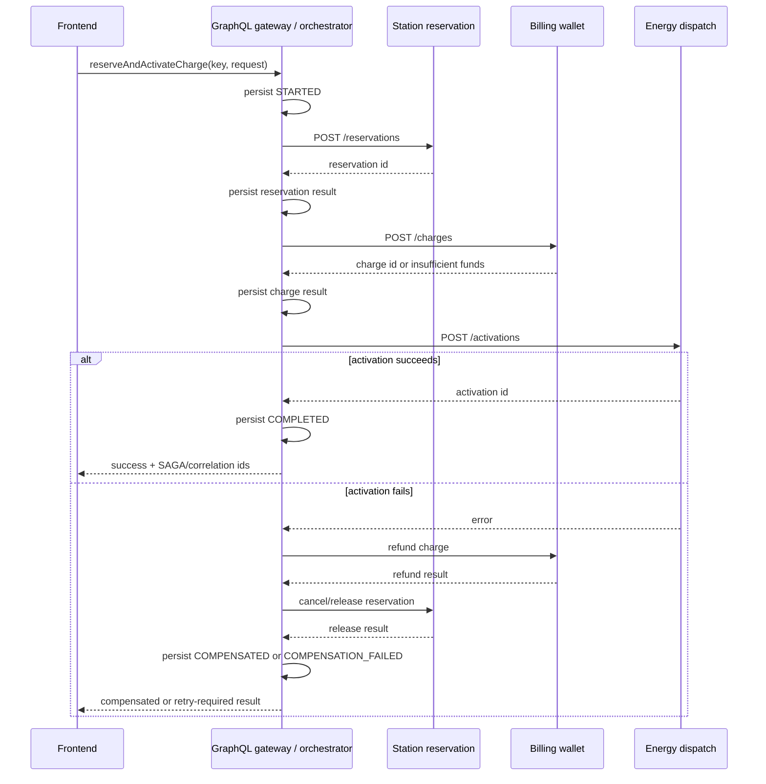

# SAGA Design

**Current implementation:** orchestrator in `gateway/app.py`. **Target:**
demonstrate the required reservation, debit, activation, and compensating
transactions with auditable progress. This document distinguishes observed
behavior from required hardening.

## 1. Business transaction

### Forward path

1. **Reserve**: station-reservation receives station id, connector id, wallet
   id, and idempotency key; returns a reservation record.
2. **Charge**: billing-wallet debits the wallet and records a charge.
3. **Activate**: energy-dispatch activates the connector.
4. **Complete**: gateway persists the final SAGA state and reports the result.

### Compensation

- Reservation fails: no later effect should occur; reject the SAGA.
- Billing fails for insufficient funds: cancel/release the reservation.
- Activation fails after a charge: refund the charge first, then release the
  reservation. This is reverse order of completed forward effects.
- A transport timeout is an uncertain outcome, not proof that the service did
  nothing. Retry/compensate only with idempotent service operations and
  persisted step state.



## 2. Current state and persistence

Current SAGA records use the `id` partition key and contain `id`,
`correlation_id`, `state`, per-step status fields, request identifiers/data,
optional error, and optional fault flag. Gateway uses
`saga_id = "saga-" + idempotency_key`, creates the SAGA record before remote
calls, and writes state after successful steps.

State strings observed include `STARTED`, `RESERVATION_COMPLETED`,
`CHARGE_COMPLETED`, `COMPLETED`, `FAILED`, `COMPENSATED`, and
`COMPENSATION_FAILED`. These are strings, not a declared enum. The frontend
must render returned values without assuming exhaustive enum coverage.

## 3. Important implementation discrepancies

The following are correctness risks to resolve before relying on SAGA behavior:

1. **Business failure is misreported as fully compensated.** On charge HTTP
   error, the gateway sets `COMPENSATED` before confirming cancellation
   succeeded; it does not persist the outcome of cancellation failure safely.
2. **Compensation ignores HTTP status.** `compensate()` calls synchronous
   `httpx.post()` without `raise_for_status()`. A 4xx/5xx response can be
   treated as a successful refund/release.
3. **Potential duplicate side effects.** Gateway performs `get_saga` then
   `put_item` without conditional write/transaction. Concurrent requests with
   the same key can both execute. Same key with different payloads is not
   rejected.
4. **Billing is not atomic.** Wallet balance update and charge record are
   separate DynamoDB writes; duplicate/concurrent debits and refunds can corrupt
   the balance.
5. **Reservation does not lock connector inventory.** Repeated reservations
   can reserve the same connector, and the station listing remains unchanged.
   In addition, the station service scans reservation items from the same
   table as station records and may return them as invalid stations, causing
   GraphQL station resolution to fail after a reservation.
6. **Retry is not state-restricted.** `retryCompensation` calls compensation
   even for completed or otherwise ineligible records.
7. **Missing event log.** Per-step events, retry count, compensation outcome,
   timestamps, and a durable resumable execution cursor are not exposed by the
   GraphQL SAGA type.
8. **Technical uncertainty is under-specified.** No durable lease/worker
   recovery exists for gateway termination between remote success and local
   persistence.

The frontend must not hide these limitations or claim strong idempotency.

## 4. Target state model

Recommended state machine for implementation (names should be finalized in a
backend contract change):

```text
STARTED -> RESERVATION_COMPLETED -> CHARGE_COMPLETED -> COMPLETED
   |                |                    |
   v                v                    v
REJECTED       COMPENSATING <-------- COMPENSATING
                    |
        +-----------+------------------+
        v                              v
  COMPENSATED                 COMPENSATION_FAILED
                                      |
                                      +--> COMPENSATING (eligible retry)
```

Persist before and after each external side effect. Record step attempt,
outcome, service response identifier, error classification, timestamps, and
pending compensation order. Terminal states must be immutable except for
audited administrative recovery.

## 5. Idempotency and correlation requirements

- Require a client-generated idempotency UUID per user intent.
- Persist a canonical request fingerprint with conditional create.
- Same key + same fingerprint returns the existing transaction/result without
  duplicate effects.
- Same key + different fingerprint returns a typed conflict.
- Propagate one correlation id across gateway, all microservices, logs, and
  SAGA records.
- Service-side reserve, charge, refund, activate, release operations must be
  individually idempotent; use conditional writes and atomic updates/transactions
  where required.

Current code does not guarantee these properties, despite returning a stable
SAGA for sequential duplicate keys.

## 6. Frontend contract

The current reserve mutation returns only `success`, `sagaId`,
`correlationId`, `state`, and `message`. The history query returns only overall
and three step statuses plus error. Consequently, the first frontend pass can
show a summary and returned state, but cannot truthfully show a timeline,
compensation order, number of attempts, or individual refund/release outcomes.

Retry control should be available only for `COMPENSATION_FAILED`; the backend
must enforce this too. On a network timeout, the UI should retain and reuse the
same idempotency key because the outcome may be unknown.

## 7. Verification scenarios

Backend tests should exercise:

1. Full success, with one reservation, debit, activation, and terminal state.
2. Reservation rejection, with no charge/dispatch.
3. Insufficient funds, with successful release and no charge.
4. Activation fault, with refund then release in that order.
5. Refund failure, preserving pending refund and not releasing prematurely.
6. Release failure, preserving pending release and allowing safe retry.
7. Timeout after remote side effect, followed by idempotent retry/recovery.
8. Duplicate identical key, including concurrent submissions.
9. Duplicate key with changed input, returning conflict.
10. Retry of a terminal/non-retryable SAGA, rejected without side effects.

Current repository has a few mocked success/failure tests, but not all of these
scenarios or real GraphQL contract tests.
