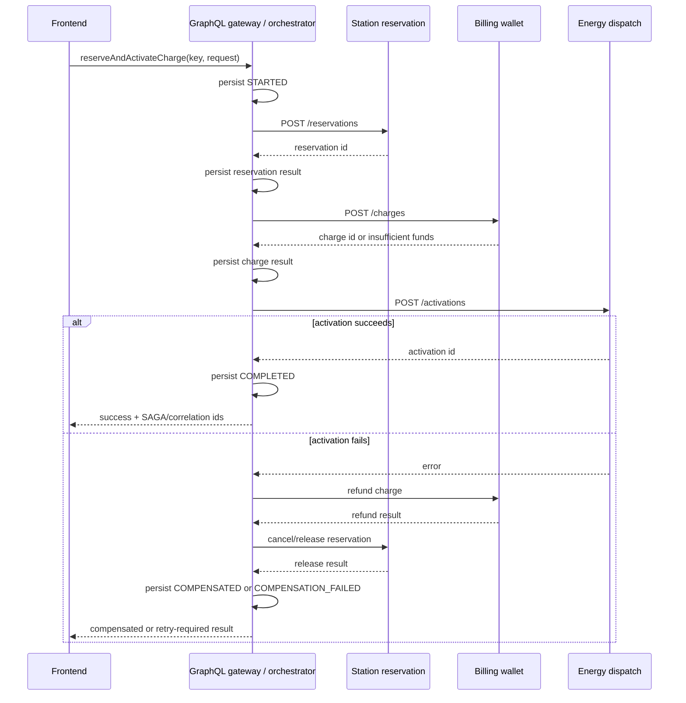

# SAGA Design

**Current implementation:** orchestrator in `gateway/app.py`. **Target:**
demonstrate the required reservation, debit, activation, and compensating
transactions with auditable progress. This document distinguishes observed
behavior from required hardening.

## 1. Business transaction

### Forward path

1. **Reserve**: station-reservation receives station id, connector id, wallet
   id, and idempotency key; returns a reservation record.
2. **Charge**: billing-wallet debits the wallet and records a charge.
3. **Activate**: energy-dispatch activates the connector.
4. **Complete**: gateway persists the final SAGA state and reports the result.

### Compensation

- Reservation fails: no later effect should occur; reject the SAGA.
- Billing fails for insufficient funds: cancel/release the reservation.
- Activation fails after a charge: refund the charge first, then release the
  reservation. This is reverse order of completed forward effects.
- A transport timeout is an uncertain outcome, not proof that the service did
  nothing. Retry/compensate only with idempotent service operations and
  persisted step state.



## 2. Current state and persistence

Current SAGA records use the `id` partition key and contain `id`,
`correlation_id`, a request fingerprint, per-step status fields, request
identifiers/data, errors, pending compensations, a bounded execution lease, and
an `events` list. Gateway uses `saga_id = "saga-" + idempotency_key` and
conditionally creates that item before remote calls. It persists each step
transition and compensation outcome.

State values are strings, not a declared enum. They include `STARTED`,
`RESERVING`, `RESERVATION_COMPLETED`, `RESERVATION_UNCERTAIN`, `CHARGING`,
`CHARGE_COMPLETED`, `CHARGE_UNCERTAIN`, `CHARGE_FAILED`, `ACTIVATING`,
`ACTIVATION_UNCERTAIN`, `COMPENSATING`, `COMPENSATED`,
`COMPENSATION_FAILED`, `COMPLETED`, and `FAILED`. The frontend must render
returned values without assuming exhaustive enum coverage.

## 3. Implemented correctness controls and remaining limits

The backend now applies the following controls:

1. **Conditional SAGA creation and request fingerprinting:** concurrent or
   sequential requests using the same key share one SAGA; a changed payload is
   rejected before downstream calls.
2. **Service idempotency:** reservation, charge, refund, and activation records
   are keyed by request identity. Wallet debit/charge and refund/ledger changes
   use DynamoDB transactions. Connector locks use conditional writes with
   recoverable `reserving`/`cancelling` states.
3. **Uncertain outcomes:** gateway retries idempotent downstream POSTs once.
   If the result remains uncertain, it persists an uncertain step state and
   releases the lease; retrying the same GraphQL request resumes that step.
4. **Compensation:** refund is confirmed before connector release; every
   response status and body state is checked. Failed actions remain pending
   and `COMPENSATION_FAILED`; retry is guarded and service idempotency prevents
   duplicate refund/release effects.
5. **Audit:** the SAGA item stores timestamps and per-step/compensation events.
   These events are not exposed by the current GraphQL type.

Remaining limits: gateway recovery is request-driven rather than a background
worker; a client or operator must retry the same idempotency request after an
uncertain forward step. The 120-second lease and event list are stored in one
DynamoDB item; DynamoDB's 400 KB item ceiling limits long-lived retry history.
Only one hard-coded station/connector is in the current inventory. The tested
integration uses Moto and in-process ASGI; Docker/Floci and live AWS behavior
remain unverified.

## 4. Target state model

Implemented runtime state flow (all values are strings):

```text
STARTED -> RESERVATION_COMPLETED -> CHARGE_COMPLETED -> COMPLETED
   |                |                    |
   v                v                    v
REJECTED       COMPENSATING <-------- COMPENSATING
                    |
        +-----------+------------------+
        v                              v
  COMPENSATED                 COMPENSATION_FAILED
                                      |
                                      +--> COMPENSATING (eligible retry)
```

The gateway persists a step start before each external side effect and the
confirmed/uncertain result afterward. `COMPENSATION_FAILED` and stale
`COMPENSATING` states can be retried; terminal success/failure states are not
re-run. The GraphQL model still returns only the summary status fields.

## 5. Idempotency and correlation requirements

- Require a client-generated idempotency UUID per user intent.
- Persist a canonical request fingerprint with conditional create.
- Same key + same fingerprint returns the existing transaction or resumes an
  uncertain step after the current execution lease is released/expired.
- Same key + different fingerprint returns a GraphQL execution error.
- Propagate one correlation id across gateway, all microservices, logs, and
  SAGA records. Structured cross-service logging is still incomplete.
- Service-side reserve, charge, refund, activate, and release operations use
  conditional/idempotent records. Billing uses atomic transactions and the
  station lock uses conditional single-item writes with resumable state.

## 6. Frontend contract

The current reserve mutation returns only `success`, `sagaId`,
`correlationId`, `state`, and `message`. The history query returns only overall
and three step statuses plus error. Consequently, the first frontend pass can
show a summary and returned state, but cannot truthfully show a timeline,
compensation order, number of attempts, or individual refund/release outcomes.

Retry control should be available for `COMPENSATION_FAILED`; the backend
enforces eligibility and returns already-compensated records without repeating
effects. On a network timeout, the UI should retain and reuse the same
idempotency key because the outcome may be unknown.

## 7. Verification scenarios

Backend tests should exercise:

1. Full success, with one reservation, debit, activation, and terminal state.
2. Reservation rejection, with no charge/dispatch.
3. Insufficient funds, with successful release and no charge.
4. Activation fault, with refund then release in that order.
5. Refund failure, preserving pending refund and not releasing prematurely.
6. Release failure, preserving pending release and allowing safe retry.
7. Timeout after remote side effect, followed by idempotent retry/recovery.
8. Duplicate identical key, including concurrent submissions.
9. Duplicate key with changed input, returning conflict.
10. Retry of a terminal/non-retryable SAGA, rejected without side effects.

The Phase 1 suite covers successful GraphQL charging, insufficient balance,
hardware activation failure, confirmed and failed compensation/retry,
duplicate and concurrent SAGA requests, concurrent connector reservation,
duplicate charge/refund, and a lost charge response followed by same-key
recovery. Tests run against Moto-backed DynamoDB with the actual FastAPI apps
and in-process ASGI routing; they are not Docker/Floci/AWS deployment tests.
