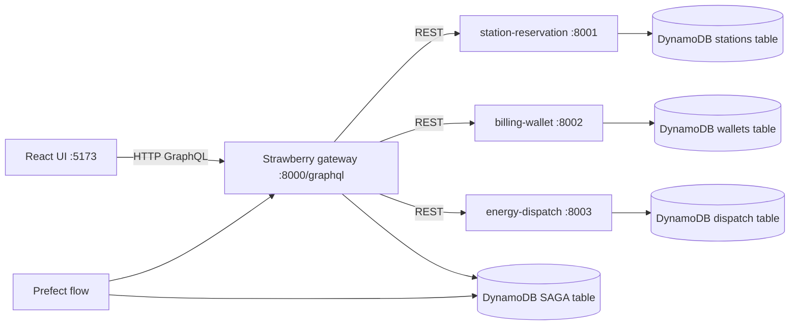

# AegisVolt Architecture

> This is the expanded canonical architecture document requested as
> `docs/ARCHITECTURE.md`. The existing file is stored as `architecture.md`;
> Windows treats the two spellings as the same path.
>
> Audit baseline: 2026-11-20. This describes the checked-in implementation
> separately from the required target. A declared resource is not evidence that
> it has been applied to AWS or Floci.

## 1. System purpose and academic constraints

AegisVolt is a cloud-native electric-fleet charging demonstration. Its core
business flow is to reserve a connector, debit a fleet wallet, and activate
energy dispatch. If a later step fails, the system must compensate completed
steps in reverse business order. The official assignment also requires
independent `dev`, `test`, and `prod` environments, a React or equivalent UI,
GraphQL, at least three Dockerized microservices, Terraform, Kubernetes,
CloudWatch, Prefect, and a gated feature/* -> dev -> test -> prod promotion
path. See [REQUIREMENTS_TRACEABILITY.md](./REQUIREMENTS_TRACEABILITY.md).

## 2. Current repository shape

```text
frontend/                     React + TypeScript + Vite, one dashboard screen
gateway/                      FastAPI + Strawberry GraphQL BFF/orchestrator
services/
  station-reservation/        FastAPI; station listing and reservations
  billing-wallet/             FastAPI; wallet, debit, refund
  energy-dispatch/            FastAPI; activation and telemetry
common/dynamodb.py            boto3 resource configuration
infra/                        Terraform bootstrap, root, and partial modules
k8s/                          namespace, gateway deployment, canary ingress
observability/prefect/        one health/SAGA-count flow
scripts/                      canary health check and branch protection helper
tests/                        SAGA unit-style tests and a compensation shape test
```

The tracked source inventory and existing documentation are summarized in
`project-management/IMPLEMENTATION_STATUS.md`. Generated frontend dependencies,
build output, Python bytecode, and pytest cache are not source-of-truth.

## 3. Current runtime architecture



Docker Compose exposes Floci on 4566, the domain services on 8001-8003, and the
gateway on 8000. It does **not** expose separate GraphQL gateways for each
environment. The frontend is started separately using Vite; it is not a
Compose service.

The only configured local GraphQL endpoint is
`http://localhost:8000/graphql`, and the gateway's `ENVIRONMENT` defaults to
`dev` because Compose does not set it. Test and prod GraphQL endpoints are not
configured. The frontend's current test/prod defaults target the billing and
dispatch REST ports and must not be used. The existing Vite `/graphql` proxy
can reach the dev gateway when the client uses a relative URL.

The gateway reports `canaryCharge` from process variable `FLAG_CANARY`
(default `true`) and `chargerFaultSimulation` from `FLAG_FAULT` (default
`false`). They are read-only and not stored per environment. They are distinct
from the mutation's direct `chargeFault` simulation input. The official
environment-scoped flags are not implemented.

### Request path

1. The browser sends a GraphQL query or mutation to the gateway.
2. The gateway calls one or more domain services over REST.
3. Each service persists its own records in a DynamoDB table using the shared
   `id` partition-key shape.
4. The gateway persists SAGA progress in a fourth table.
5. Prefect checks gateway health and counts SAGA records; its current flow does
   not audit cross-table consistency or monitor all three environments.

## 4. Current component responsibilities

| Component | Current responsibility | Important limitation |
|---|---|---|
| React UI | Renders stations, wallet, flags, reserve action, and SAGA rows; polls every 3 seconds | Single screen; no responsive rules; mutation variables do not match the declared GraphQL variables |
| GraphQL gateway | Aggregates reads and orchestrates reserve -> debit -> activate | Flags are environment variables, not DynamoDB-managed flags; no flag write, station detail, SAGA detail, or stop-charge GraphQL operation |
| Station service | Returns a station list and creates/cancels reservation records | Fallback station is hard-coded; reservation does not update connector availability |
| Billing service | Returns or seeds a wallet, creates charges, refunds | Debit, charge record, and refund are not atomic/fully idempotent |
| Dispatch service | Activates/stops and returns telemetry | Telemetry is static sample data; no timestamped/history contract |
| DynamoDB helper | Builds a boto3 resource from AWS/Floci environment variables | Startup code catches any table-load exception and may try table creation, masking non-not-found causes |
| Terraform | Declares partial network, DynamoDB, observability, API Gateway, ECR, and EKS resources | Network module only creates public subnets; API Gateway has no integration; no VPC endpoints; backend configs are not validated |
| Kubernetes | Gateway stable/canary Deployment and weighted Ingress | Only the gateway is templated; deployment script checks health/restarts, not traffic, CloudWatch error thresholds, or alarm state |
| Prefect | Gateway health check, SAGA count metrics | No three-environment health matrix, orphan detection, or consistency audit |

## 5. Target logical architecture

Keep the GraphQL gateway as the browser-facing aggregation boundary. Keep
ownership of reservations, balances/ledger entries, and dispatch sessions with
their respective services. Use an orchestrated SAGA because the business flow
has ordered steps and reverse-order compensation. Do not share writes across
service tables to simulate a distributed ACID transaction.

Each environment must have independent GraphQL configuration and independent
data: tables, flags, deployment settings, telemetry, and SAGA history must never
leak between `dev`, `test`, and `prod`. The frontend environment selector is
only safe once each environment has a real, configured GraphQL endpoint. A
client-side selector alone does not provide isolation.

## 6. Environment, networking, and infrastructure target

The official topology calls for a dedicated VPC per environment with public and
private subnets; private paths to API Gateway, cluster services, S3, DynamoDB,
and CloudWatch; EKS-hosted container workloads; and remote Terraform state in a
versioned S3 bucket. Terraform workspaces must be named `dev`, `test`, and
`prod`, and resource naming must include `terraform.workspace`.

The current Terraform is a partial scaffold, not this complete topology:

- `infra/modules/network` makes a VPC and two public subnets only.
- No VPC endpoint resources or private subnets are present.
- `infra/modules/api_gateway` creates an HTTP API without a VPC/private
  integration or route.
- `infra/modules/eks_ecr` has an EKS cluster and ECR repositories but lacks a
  node group and workload integration.
- `infra/modules/dynamodb` creates tables with a single `id` key; it does not
  yet model all documented service/environment requirements or feature flags.
- `infra/modules/observability` creates one log group and SNS topic, not
  service/environment log groups, structured correlation fields, alarms, or
  dashboards.
- `infra/backend/{dev,test,prod}.hcl` names three `CHANGE_ME` bucket names,
  while `infra/bootstrap/bootstrap.tf` creates one caller-supplied bucket.
  Bootstrap and backend configuration therefore do not align as checked in.
- Bootstrap HCL has compact one-line nested blocks with multiple attributes;
  run `terraform fmt`/`validate` before treating it as valid.
- `infra/versions.tf` declares an S3 backend, but backend HCL files and the
  deployment workflow must be checked and aligned before applying.

Provisioning, security-group rules, IAM policies, and costs must be reviewed
before real AWS use. Local Floci support is not proof of AWS readiness.

## 7. Observability target

Application logs should be JSON and include at least `correlation_id`,
`environment`, `service`, and event/level. CloudWatch log groups should be
separated by environment and service. Prefect should check all three gateways
and service health, inspect SAGA plus service records for stale/inconsistent
transactions, and publish run results/metrics to its dashboard. Automatic
recovery must remain opt-in and must not silently mutate production state.

Current code does not satisfy this target; see
`project-management/IMPLEMENTATION_STATUS.md`.

## 8. Deployment and promotion target

The official promotion chain is feature branch -> PR to `dev` -> PR from `dev`
to `test` -> PR from `test` to `prod`. Each protected branch requires passing
unit, integration, end-to-end, and Terraform plan checks; force pushes and
direct pushes are prohibited. The post-merge pipeline deploys only the target
environment and performs a measured canary with automatic rollback.

Current GitHub Actions files do not implement this complete chain: the PR
workflow runs a small test/build set, while the deployment workflow deploys on
pushes to environment branches, has job conditions that can bypass intended
dependencies, and does not perform Docker/Kubernetes canary promotion.

## 9. Frontend relation to architecture

The current page consumes the gateway schema directly. The UI must not call
domain REST endpoints directly. The precise screen specification, real GraphQL
operations, and unsupported contract gaps are in
[FRONTEND_SPECIFICATION.md](./FRONTEND_SPECIFICATION.md) and
[GRAPHQL_CONTRACTS.md](./GRAPHQL_CONTRACTS.md). No new GraphQL fields may be
assumed by a frontend implementation.

## 10. Decision and change control

Treat the official DOCX as the requirement authority, the running schema/source
as the current contract, and planning documents as a target proposal. When the
actual contract changes, update the GraphQL contract and traceability documents
in the same PR. Do not describe planned resources, screens, or features as
implemented until code and tests demonstrate them.
